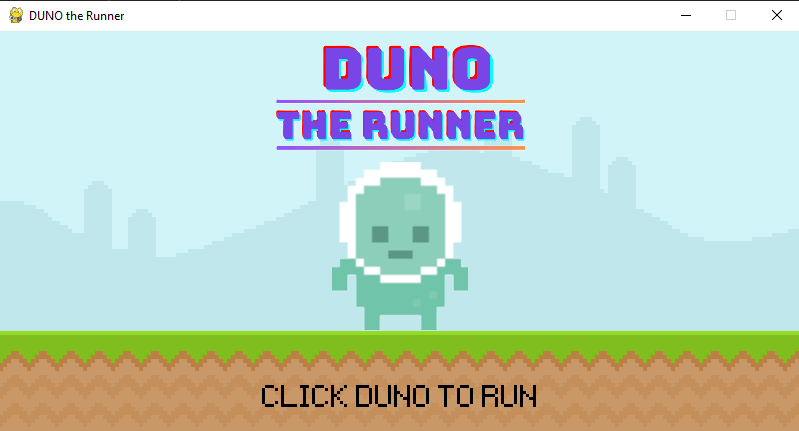

# 🏃 DUNO the Runner

An endless 2D side-scrolling runner game built in Python using **Pygame**. Help DUNO run, jump, and survive as long as possible by dodging crawling snails and airborne flies while your score climbs!

---

## 📸 Preview

<div align="center">
  <!-- Place your gameplay screenshot or demo GIF in the Graphics folder and update the path below -->
  
</div>

---

## 🎮 Gameplay & Mechanics

- **Endless Running**: The player runs continuously across a scrolling 800×400 retro landscape.
- **Dynamic Obstacles**:
  - 🐌 **Snails**: Crawl along the ground.
  - 🪰 **Flies**: Swoop through the air at jump height.
- **Adaptive Difficulty**: Obstacle movement accelerates progressively over time, demanding quicker reflexes.
- **Sprite Animations**: Frame-by-frame walking cycles for the player, snails, and flies, complete with dedicated jump sprites.
- **Score System**: Live score tracking based on survival duration, displayed on the game screen and summarized upon game over.
- **State Management**: Clean state flow between Start Screen, Active Run, and Game Over / Replay.

---

## 🕹️ Controls

| Action | Control | Description |
| :--- | :--- | :--- |
| **Start Game** | `Left Click` on DUNO | Click the character on the title screen to start running |
| **Jump** | <kbd>Spacebar</kbd> | Jump into the air to dodge ground hazards |
| **Replay** | `Left Click` on REPLAY | Restart the run after a collision |
| **Quit Game** | Window Close Button (<kbd>X</kbd>) | Exit the game cleanly |

---

## 📁 Project Structure

```text
The Runner game/
├── the_runner_game.py     # Main game loop, rendering & logic
├── README.md              # Project documentation
├── Font/
│   └── Pixeltype.ttf      # Retro pixel arcade font
├── Graphics/
│   ├── Sky.png            # Sky background surface
│   ├── ground.png         # Ground floor surface
│   ├── DUNO2.png          # Title character banner
│   ├── GAME OVER2.png     # Game Over banner
│   ├── screenshot.png     # (Optional) Gameplay screenshot for README
│   ├── Player/            # Stand, walk_1, walk_2, and jump sprites
│   ├── Snail/             # Animated snail obstacle sprites
│   └── Fly/               # Animated fly obstacle sprites
└── Audio/
    ├── audio_jump.mp3     # Jump sound effect
    └── music.wav          # Background music track
```

---

## 🚀 Getting Started

### Prerequisites

- **Python 3.10+** (Fully tested on Python 3.12 and Python 3.14)
- **Pygame** or **Pygame-CE**

### 1. Installation

Install the required library via `pip`:

```bash
# Standard Pygame (Python 3.10 - 3.12)
pip install pygame

# Or Pygame Community Edition (Recommended for Python 3.13+)
pip install pygame-ce
```

### 2. Run the Game

Navigate to the game directory and run:

```bash
python the_runner_game.py
```

*Tip: If you have multiple Python versions installed on Windows:*
```powershell
py -3.12 the_runner_game.py
```

---

## 🛠️ Planned Enhancements

- [ ] Connect sound effects from `Audio/` (`audio_jump.mp3` & `music.wav`)
- [ ] Local high score saving (persistent leaderboard)
- [ ] Collectible items / power-ups (double jump, shield)
- [ ] Day / Night cycle or changing sky themes

---

## 📜 License

This project is created for educational and entertainment purposes. Feel free to modify, expand, and create your own runner adventures!
